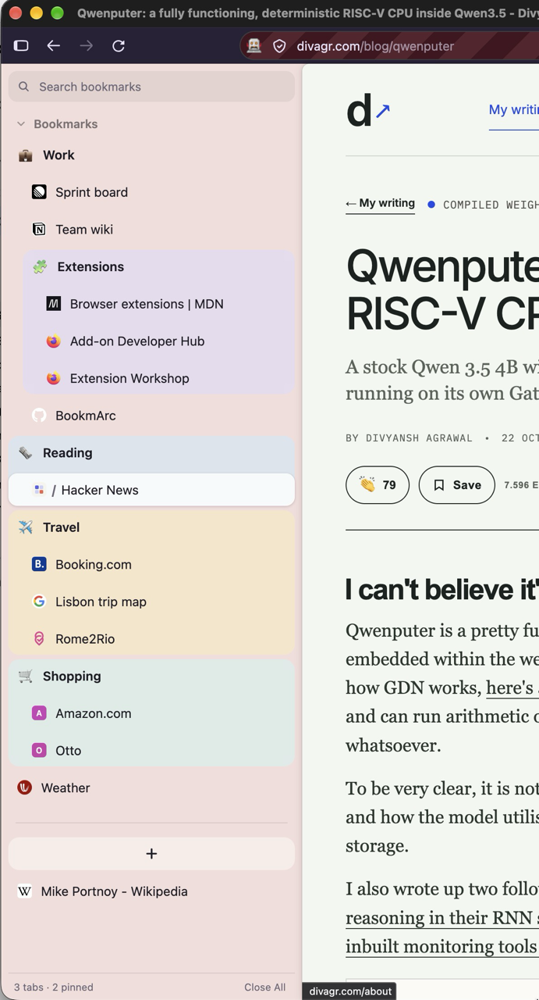

<p align="center">
  
</p>

<h1 align="center">BookmArc</h1>

<p align="center">Your Firefox bookmarks as an Arc-style sidebar.</p>

BookmArc is one sidebar, nothing more: your bookmarks toolbar as Arc's pinned tabs, with folders, favorites and the open tabs below. A bookmark opens in its own tab, and clicking it again goes back to that same tab instead of opening another one. There are no spaces: one list, the bookmarks you already have.

<p align="center">
  
</p>

Arc is being discontinued in December 2026, so I moved to Firefox and rebuilt the part of Arc I used most. It started as a fork of [trajche/arc](https://github.com/trajche/arc)

> Not affiliated with or endorsed by The Browser Company. “Arc” is their browser; this is an independent extension that brings its sidebar ideas to Firefox.

## Install

Needs **Firefox 155 or newer** (desktop).

### 1. The add-on

Download the latest `.xpi` from [Releases](https://github.com/chokity/BookmArc/releases) and drag it into a Firefox window (or `about:addons` → ⚙ → *Install Add-on From File…*). New versions are installed the same way; your favorites and settings are kept.

If the original Arcsidebar is installed too, disable it: both would handle `⌘T` and `⌘W`.

If the sidebar doesn't show up, open it once with `⌥⇧A` / `Alt+Shift+A` or *View → Sidebar → BookmArc*. Firefox remembers it from then on.

### 2. The layout (`userChrome.css`)

An extension can't change Firefox's own window: hiding the tab strip and shaping the page takes a user stylesheet, `userChrome.css`, in your Firefox profile. With it:

- Firefox's **tab strip is hidden**; the sidebar lists the tabs.
- Firefox's **toolbar stays on top** (back, forward, reload, address bar, extension buttons), below the native title bar with the window buttons.
- The page sits next to the sidebar as a **card with a rounded corner and a soft shadow**, like Arc.
- The sidebar's **“BookmArc ×” header** is hidden.

#### Option A: setup script (recommended)

Quit Firefox (`⌘Q`), then run the script for your system. It finds the Firefox profile that has this add-on installed and adds the layout there; your own CSS and prefs in those files are kept (it only manages its own marked block).

**macOS / Linux** (Terminal)
```sh
curl -fsSL https://raw.githubusercontent.com/chokity/BookmArc/main/extras/setup/bookmarc-setup.txt | bash
```

**Windows** (PowerShell)
```powershell
irm https://raw.githubusercontent.com/chokity/BookmArc/main/extras/setup/bookmarc-setup.ps1 | iex
```

Then start Firefox. Run the script again after updating the add-on, in case the layout changed. To read the scripts first: [`bookmarc-setup.txt`](extras/setup/bookmarc-setup.txt), [`bookmarc-setup.ps1`](extras/setup/bookmarc-setup.ps1). From a clone of this repository, `bash extras/setup/bookmarc-setup.txt` does the same.

To remove the layout again: `curl -fsSL … | bash -s -- --uninstall` on macOS/Linux, or `& ([scriptblock]::Create((irm <url>))) -Uninstall` on Windows.

What the script changes in the profile:

- `chrome/userChrome.css`: the layout above (from [`extras/userChrome.css`](extras/userChrome.css)).
- `user.js` (from [`extras/user.js`](extras/user.js)):
  - turns `userChrome.css` on (`toolkit.legacyUserProfileCustomizations.stylesheets`)
  - horizontal tabs (`sidebar.verticalTabs = false`; their strip is hidden anyway)
  - the native title bar (`browser.tabs.inTitlebar = 0`), which holds the window buttons once the tab strip is gone
  - keeps the window open when its last tab closes
  - restores the session, including the open sidebar
  - turns on Picture-in-Picture when switching away from a playing video, like Arc
- `prefs.js`: opens the sidebar once on a profile that has never shown it.
- `customKeys.json`: clears Firefox's own *New Tab*, *Close Tab* and address-bar (`⌘L`) shortcuts, so `⌘T` / `⌘W` / `⌘L` reach the add-on. Undo in `about:keyboard`.

#### Option B: by hand

1. Open `about:support`, find **Profile Folder** and click **Open Folder** (Finder / Explorer).
2. In that folder, create a folder named `chrome` if there isn't one.
3. Save [`extras/userChrome.css`](extras/userChrome.css) into it as `chrome/userChrome.css`. If a `userChrome.css` is already there, append the contents instead of replacing it.
4. Save [`extras/user.js`](extras/user.js) into the profile folder as `user.js` (or append to an existing one). At minimum, `about:config` → `toolkit.legacyUserProfileCustomizations.stylesheets` must be `true`.
5. Restart Firefox. Changes to `userChrome.css` always need a restart.

To undo: delete (or empty) `chrome/userChrome.css` and the lines you added to `user.js`, then reset the prefs in `about:config` if you like.

## Features

- **Pinned tabs = the bookmarks toolbar**, both ways: pinning, renaming, moving and unpinning in the sidebar change the bookmarks (unpinning deletes one), and changes made in Firefox show up in the sidebar. Folders included; their emoji, color and open/closed state are kept by the add-on. Separators and smart bookmarks ("Most Visited") are left out of the sidebar and never touched. A closed pinned tab keeps its place; once its tab has left the pinned page the row reads "icon / name", and the icon goes back.
- **Open tabs are matched to bookmarks and favorites** by address (exact, then without `www.`, the fragment or a trailing slash, then without the query), on start and whenever the sidebar opens.
- **Search** at the top: shows only the bookmarks (and tabs) whose title or address has every word typed, with their folders opened just for the search. `Enter` opens the first hit, `Esc` clears; typing anywhere in the sidebar or `⌘F` starts a search.
- **Folding**: a closed folder keeps its open tabs in view below it; folding "Bookmarks" away leaves only the open ones.
- **Folders**: "…" on a folder's row (or right-click) for Rename, Change Icon (emoji with search), **Set Color…** (a colored area behind the folder and what's shown below it), Open / Close its tabs, nested folders, Ungroup, Delete.
- **Favorites**: drag a tab or a pinned item to the top; drag tiles to reorder.
- **Open tabs** below the divider; empty tabs (new-tab pages, the command bar) aren't listed, and "Close Empty Tabs" closes them. Split views show as one row.
- **Status bar** at the bottom: how many tabs are open, and **Close All** to close every tab in the window (a second click confirms).
- **Multi-select** with `⇧`-click and `⌘`-click, then right-click: copy links, new folder with the items, close tabs, remove pins.
- **Menus** on tabs, pinned items, folders and favorites: duplicate, reload, mute, back to saved URL / save current URL, close tabs above/below, …; "Add to Favorites" and "Pin to Bookmarks Toolbar" also in Firefox's own page menu.
- **Theme**: `#f3dddb` by default, or any color with an intensity, light or dark text, and **Sizing** (font, row height, spacing, folder indent and icon): right-click "Bookmarks".
- **Command bar**: `⌘T`, the "+" above the open tabs, or a double-click below them. `Tab` on a site searches inside it. `⌘L` / `Ctrl+L` opens it with the current tab's address selected, like Arc: what you pick loads in that tab.
- **Memory**: tabs idle for 45 minutes are unloaded.

## Limits

Firefox doesn't allow extensions to:

- Draw over the page. Arc's floating command bar becomes a tab here.
- Open `about:` pages (click Firefox's address bar) or create split views.
- Draw outside the sidebar: menus and submenus open inside it.
- Give the sidebar's theme to Firefox's own panels (bookmarks, history): `userChrome.css` paints them in the default color.

Pinned tabs are your bookmarks (synced by Firefox Sync if it's on). Favorites, theme, sizing and the folders' emoji, colors and open state are stored locally in the profile.

## Tab badges for other extensions

Other extensions can put small badges on tabs in the sidebar and add items to its tab menu, by messaging this add-on (`bookmarc@pliha`). See the comment above `onMessageExternal` in `background.js`, or the [original README](https://github.com/trajche/arc#tab-badges-for-other-extensions). Since 0.7.0 the message types are named `bookmarc:` instead of `arcsidebar:`, and the add-on ID is `bookmarc@pliha` instead of `arc@sidebar-pliha`.

## Development

```sh
npm install
npm run setup-dev   # once: creates the "bookmarc-dev" Firefox Developer Edition profile
npm run dev         # start Developer Edition with that profile (macOS)
npm run reload      # reload the add-on in place after changing code
npm run lint
```

The dev profile loads the add-on unsigned, straight from this folder, and links `extras/userChrome.css` into the profile. Code changes need `npm run reload`; `userChrome.css` changes need a Developer Edition restart. The striped address bar with a robot icon in that window is Firefox marking remote control, which `npm run reload` uses.

Release Firefox only runs signed add-ons. To sign your own build without publishing it:

1. Create API keys at [addons.mozilla.org → Developer Hub → API Keys](https://addons.mozilla.org/developers/addon/api/key/) and put them in `.env` (git-ignored):
   ```sh
   WEB_EXT_API_KEY=user:…
   WEB_EXT_API_SECRET=…
   ```
2. `npm run sign` bumps the patch version and uploads an *unlisted* build: it's signed but not listed on addons.mozilla.org. The signed `.xpi` lands in `web-ext-artifacts/`. If it times out while waiting, don't run it again (that burns the next version number); fetch the file with `node scripts/amo.mjs fetch <version> web-ext-artifacts/bookmarc-<version>.xpi --wait-minutes 45`.

Other scripts:

- `npm run build:setup` regenerates `extras/setup/` from `extras/userChrome.css` and `extras/user.js`. Run it after changing either.
- `npm run sign:listed` signs a *listed* build instead: it goes to addons.mozilla.org for review and is published there, with the page text from [`docs/amo-metadata.json`](docs/amo-metadata.json) (the same text for the Developer Hub is in [`docs/amo-listing.md`](docs/amo-listing.md)). Firefox then keeps installed copies up to date itself. `./sign.sh minor --listed` bumps the minor version instead.
- `npm run build` packs an unsigned `.zip` (for Developer Edition / Nightly, or `about:debugging` → *Load Temporary Add-on*).

| Path | What |
|---|---|
| `background.js` | Command bar tabs (`⌘T` / `⌘L` / `⌘W`), Firefox's menus, binding tabs, badges, unloading idle tabs |
| `shared/store.js` | Data: favorites, the bookmarks toolbar as pinned items, theme, tab bindings |
| `shared/theme.js`, `theme.css`, `tint.js` | Theme colors, light and dark |
| `shared/` | Also badges, suggestions, DOM helpers and the emoji data |
| `sidebar/` | The sidebar: search, favorites, pinned tabs and folders, tab list, menus and dialogs |
| `palette/`, `newtab/` | Command bar and the new-tab page that opens it |
| `extras/` | `userChrome.css`, `user.js` and the generated setup scripts |
| `scripts/` | Dev tooling: setup-script generator, dev profile, reload, signing helper |

## License

[MIT](LICENSE), like the original. Icons from [Lucide](https://lucide.dev) (ISC). Emoji data from [unicode-emoji-json](https://github.com/muan/unicode-emoji-json) and [emojilib](https://github.com/muan/emojilib) (MIT, see [`shared/emoji.LICENSE.txt`](shared/emoji.LICENSE.txt)).
